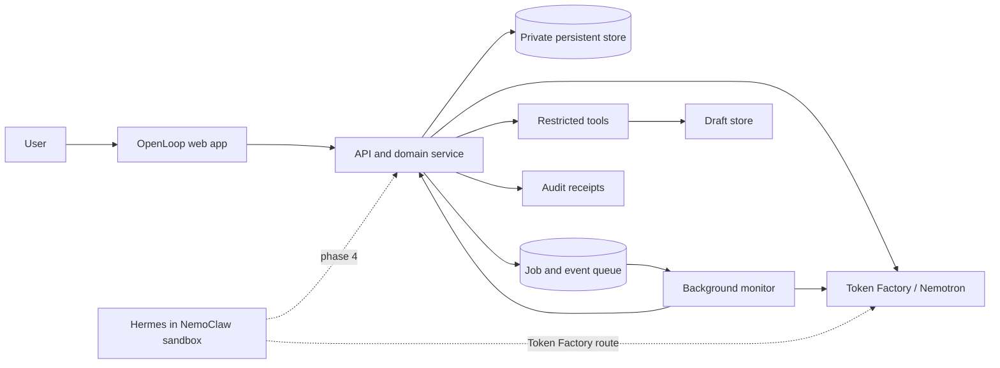
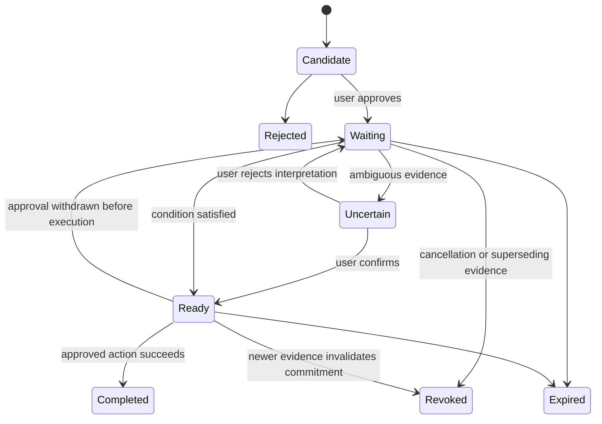

# OpenLoop Implementation Plan

## Implementation Status - October 3, 2026

The live-model vertical slice is implemented with
`nvidia/NVIDIA-Nemotron-3-Nano-30B-A3B` on Nebius Token Factory. The earlier Super
recommendation below was provisional; see [Model Selection](docs/MODEL_SELECTION.md)
for actual account availability and observed tests.

Delivered: consented source import, grounded candidate extraction, review/correction,
persistent SQLite memory, live evidence evaluation, scoped draft generation, explicit
local-save approval, model provenance, stale-draft invalidation and source deletion.

The requirements map below remains a target, not a claim of complete compliance.
Always-on monitoring, source connectors, memory expiry, public-demo authentication,
and submission artifacts are still pending. The current monitor is manual and
drafts are saved locally, never sent. See README for the current privacy boundaries.

## 1. Product decision

OpenLoop is a private personal follow-through agent. It remembers commitments from
user-approved sources, watches for the conditions that make those commitments
actionable, explains the evidence behind each state change, and prepares an approved
follow-up action.

The first target user is a freelancer or consultant managing several client projects.
This gives the demo a concrete audience, realistic repeated workflows, and a clear
cost for missed follow-ups.

Core example:

> When Maya approves the final scope for Project Mercury, prepare the proposal using
> my usual format. Ask me before saving or sending it.

OpenLoop must distinguish among incomplete approval, explicit approval, revocation,
irrelevant evidence, and duplicate events. It must never execute an external action
based only on an uncertain interpretation.

## 2. Hackathon alignment

Official baseline requirements:

| Requirement | OpenLoop implementation | Evidence for judges |
| --- | --- | --- |
| Runs on Nebius Token Factory or Nebius AI Cloud | Runtime calls to the Token Factory OpenAI-compatible API | Request logs, architecture view, README configuration |
| Uses an NVIDIA open-source model | Use an eligible NVIDIA Nemotron model available in the participant's Token Factory account | Model ID shown in settings and demo architecture |
| Always-on personal assistant | A background monitor checks newly approved source events and pending conditions | Worker status, last-run time, trigger timeline |
| Private and user-controlled | Sources are opt-in; model calls receive scoped excerpts; actions and retention are explicit | Access preview, source controls, audit receipt, deletion flow |
| Persistent memory | Commitments, evidence, skills, decisions, and action history survive sessions | Close/reopen or start a new session in the demo |
| Reusable skills | Versioned `daily_briefing` and `prepare_follow_up` skill definitions | Skills screen with inputs, tools, and approval policy |
| Chosen tools and information | Each skill has a source scope and tool allowlist | Permission manifest and denied-action test |
| Carries out tasks | Produces a real proposal or follow-up draft after a trigger is satisfied | Saved draft artifact and execution receipt |
| Working application | Hosted or test-build URL with seeded demo workspace | Public demo URL and test credentials if required |
| Public repository and license | Complete source, setup instructions, architecture, and an MIT or Apache-2.0 license | Repository root |
| Demo video under three minutes | One end-to-end story with narration of Nebius and Nemotron usage | Public YouTube link |

The four judging criteria are equally weighted. The project will address them as
follows:

- **Technological implementation:** structured Nemotron extraction, evidence matching,
  deterministic state transitions, scoped tool execution, idempotency, and an
  evaluation suite.
- **Design:** a coherent inbox-to-action workflow rather than a general chat surface.
- **Potential impact:** missed and premature follow-ups for independent professionals,
  measured with a small user study and a labeled test set.
- **Quality of idea:** event-conditioned personal memory with evidence, validity
  checks, and reversible actions.

## 3. Scope

### MVP capabilities

1. Import or paste meeting notes, messages, and project updates.
2. Extract candidate commitments with exact source quotations.
3. Let the user approve, edit, reject, expire, or delete a candidate.
4. Persist approved commitments across sessions.
5. Represent trigger conditions and evaluate new evidence against them.
6. Use `waiting`, `uncertain`, `ready`, `revoked`, `completed`, and `expired` states.
7. Prepare a follow-up document through a reusable skill.
8. Require approval before saving or sending an external-facing artifact.
9. Show a complete audit timeline for every model judgment and action.
10. Delete derived memories and pending actions when their source is deleted.

### Deliberately deferred

- Broad inbox access and multiple production email providers.
- Autonomous sending in the initial version.
- Automatic skill discovery from arbitrary behavior.
- General web browsing and unrestricted computer control.
- Multi-user collaboration and enterprise administration.
- Claims of end-to-end local processing when Token Factory receives scoped excerpts.

## 4. Technical architecture

Use a TypeScript monorepo so the UI, API schemas, database types, and model output
schemas share one type system.

Recommended stack:

- Next.js with TypeScript for the web application and API.
- PostgreSQL for deployed persistence; SQLite may be used only for the first local
  vertical slice.
- Drizzle ORM and migrations.
- OpenAI JavaScript SDK configured with
  `https://api.tokenfactory.nebius.com/v1/`.
- Zod schemas for API input, skill specifications, and model structured output.
- A database-backed worker queue with explicit leases and idempotency keys. Avoid a
  second queue service in the MVP.
- Vitest for domain tests and Playwright for the core browser workflow.



### Why the agent boundary is split

Nemotron handles language understanding:

- candidate commitment extraction;
- trigger normalization;
- relevance and condition evaluation;
- contradiction or revocation detection;
- concise explanations;
- draft generation.

Application code controls authority:

- source access;
- memory writes;
- state transitions;
- deduplication;
- tool permissions;
- approval requirements;
- deletion and expiry;
- action execution.

The model may propose a transition or tool call. It cannot commit either directly.

## 5. Nemotron and Nebius usage

### Model selection

At setup time, call `GET /v1/models?verbose=true` with the participant's Token Factory
key and select an available NVIDIA Nemotron model that supports the required output
mode. The initial candidate is Nemotron 3 Super for reasoning and structured
extraction. The exact model ID must come from the live account rather than being
hard-coded from marketing text.

Use one model first. Add a smaller Nemotron model only after evaluation shows a clear
latency or cost benefit.

### Model calls

| Call | Input | Output | Guardrail |
| --- | --- | --- | --- |
| Extract candidates | Approved source text | Candidate commitments and exact quote spans | Schema validation and user approval |
| Normalize condition | Approved candidate | Typed trigger specification | User can edit before activation |
| Evaluate evidence | Pending trigger plus relevant source excerpt | `satisfied`, `unsatisfied`, or `uncertain` with quoted evidence | Only `satisfied` can propose `ready` |
| Check validity | Commitment plus newer evidence | `valid`, `revoked`, `superseded`, or `uncertain` | Conflicts stop execution |
| Generate draft | Approved skill inputs and evidence | Structured draft artifact | Saved only through the restricted tool |
| Produce briefing | Active commitments and state changes | Evidence-linked summary | No new memory writes |

Use Token Factory JSON Schema output for extraction and evaluation. Use function
calling only to propose known tools. Validate every response again with Zod.

Store model observability metadata without storing secrets:

- provider and model ID;
- prompt template version;
- request purpose;
- latency and token usage where available;
- response validation result;
- IDs of the source excerpts included;
- resulting proposal and final deterministic decision.

## 6. Domain model

Primary entities:

- `Workspace`: single-user data and settings boundary.
- `Source`: imported note, transcript, message, or project update.
- `SourceExcerpt`: immutable quoted evidence with offsets or line references.
- `CommitmentCandidate`: model proposal awaiting review.
- `Commitment`: approved persistent memory.
- `Trigger`: normalized event or time condition attached to a commitment.
- `EvidenceEvaluation`: model judgment over one trigger and one or more excerpts.
- `SkillDefinition`: versioned inputs, source scope, tools, approvals, and retention.
- `ActionProposal`: proposed artifact or side effect awaiting policy checks.
- `Approval`: explicit user decision tied to an exact proposal version.
- `ExecutionReceipt`: result, timestamps, tool, inputs hash, and output reference.
- `AuditEvent`: append-only explanation of every meaningful state change.
- `DeletionTombstone`: prevents deleted source content from being re-derived during
  retries or re-imports unless the user explicitly restores it.

### Commitment state machine



State transitions require an idempotency key based on commitment, source event,
evaluator version, and action version. Reprocessing the same event must not produce a
second draft or notification.

### Trigger representation

Support three trigger types in the MVP:

- `time`: a timestamp or recurrence;
- `event`: a semantic event such as explicit approval or ticket closure;
- `all_of`: a small conjunction of time and event conditions.

An event trigger stores:

- natural-language condition;
- subject or project identity;
- expected actor where relevant;
- required evidence strength;
- disqualifying or revocation phrases;
- evaluation cadence;
- expiration date.

## 7. Privacy and tool control

Each model call creates a visible context receipt:

- purpose of the call;
- source excerpts included;
- model/provider receiving them;
- fields redacted;
- retention behavior inside OpenLoop.

Each skill contains a permission manifest:

```json
{
  "name": "prepare_client_follow_up",
  "allowedSources": ["project_mercury"],
  "allowedTools": ["create_draft"],
  "externalSend": "always_ask",
  "memoryWrite": "ask_on_uncertain",
  "expiresAfterDays": 30
}
```

Initial tools:

- `create_draft`: creates an internal artifact only;
- `save_draft`: writes to a configured draft destination after approval;
- `mark_commitment_complete`: updates internal state;
- `delete_memory`: performs cascading deletion with a preview.

No arbitrary shell or HTTP tool is exposed to the model.

### NemoClaw and OpenShell phase

After the core flow passes tests, run Hermes Agent inside NemoClaw/OpenShell on WSL2.
Configure Token Factory as the custom OpenAI-compatible endpoint. Expose OpenLoop's
restricted operations to Hermes through a narrow authenticated MCP or HTTP tool
surface. The OpenShell policy permits only:

- Token Factory inference;
- the OpenLoop tool service;
- explicitly selected integrations.

The demo should show one blocked network or tool request and the policy that caused
the denial. NemoClaw is currently alpha and requires Node 22.19+, Docker, at least
8 GB RAM, and approximately 20 GB of free disk, so it is an integration milestone
rather than a dependency of the initial product.

## 8. Product interface

Build the actual work surface as the first screen. Do not lead with a marketing page.

### Main views

1. **Today**
   - Ready commitments
   - Waiting commitments with current condition
   - Uncertain evidence requiring review
   - Recent completed actions
2. **Review inbox**
   - Candidate commitment
   - Exact source quote
   - Confidence and missing fields
   - Approve, edit, reject, or set expiry
3. **Commitment detail**
   - Current state and condition
   - Evidence timeline
   - Related sources
   - Prepared action and approval status
   - Correct, revoke, expire, or delete
4. **Skills**
   - Inputs, source scope, tool permissions, approval checkpoints, version
5. **Sources and privacy**
   - Connected/imported sources
   - Context access receipts
   - Retention and cascading deletion preview
6. **System status**
   - Worker heartbeat
   - Token Factory model
   - Last monitor run
   - Recent failures and retries

Chat may be added as a secondary command surface, but judges should understand the
product without using chat.

## 9. API and worker workflow

### Ingestion

1. User imports a source and selects its project scope and retention.
2. API stores the source and enqueues `extract_candidates`.
3. Worker sends only the approved source content to Token Factory.
4. Structured candidates are validated and linked to exact excerpts.
5. User reviews candidates; only approved candidates become commitments.

### Trigger monitoring

1. A new source event is stored.
2. Cheap deterministic filters identify possible pending commitments by project,
   people, and keywords.
3. The worker evaluates only the shortlisted commitment/evidence pairs with Nemotron.
4. The domain service applies the transition rules and records an audit event.
5. A ready commitment enqueues its approved skill.
6. The skill generates an action proposal and waits for approval when required.
7. Execution creates a receipt and marks the commitment completed only after success.

### Deletion

1. Show all memories, evaluations, drafts, and pending jobs derived from the source.
2. User confirms deletion.
3. Cancel pending jobs and invalidate approvals.
4. Delete content and derived records according to policy.
5. Keep a non-content tombstone and audit record proving deletion occurred.

## 10. Delivery milestones

### Current environment readiness

- WSL2 is available with about 14 GiB RAM and 65 GiB free disk, which meets the
  published NemoClaw minimums.
- Git and `uv` are installed.
- Linux Node.js is not installed; the Windows npm shim cannot find a Linux Node
  executable.
- Docker is not available inside this WSL distribution; Docker Desktop WSL
  integration must be enabled before the NemoClaw milestone.
- No `NEBIUS_API_KEY` is present in the current shell, so live model discovery cannot
  be completed until the participant key is configured.

### Milestone 0: repository and environment

- Initialize Git and add an open-source license.
- Install Linux Node 22 LTS and package manager.
- Scaffold the TypeScript app, formatting, linting, and tests.
- Add `.env.example` with no secrets.
- Add a Token Factory health check and model discovery command.
- Add fixture data for Project Mercury.

Exit gate: the app starts locally, tests run, and model discovery works when an API key
is present.

### Milestone 1: deterministic vertical slice

- Implement database schema and commitment state machine.
- Build source import, candidate review, commitment detail, and timeline UI.
- Use fixture model responses behind the same provider interface.
- Implement cascading deletion and idempotency.

Exit gate: the complete demo path works locally without a live model and survives an
application restart.

### Milestone 2: live Nemotron integration

- Implement Token Factory client.
- Add strict structured extraction, trigger normalization, evidence evaluation, and
  validity checking.
- Store context receipts and model metadata.
- Add retries, timeout handling, refusal handling, and schema-failure handling.
- Compare at least two eligible NVIDIA model configurations before fixing the model.

Exit gate: a labeled fixture set runs through the live model and produces measurable
results.

### Milestone 3: skills and controlled action

- Implement versioned skill definitions.
- Add `daily_briefing` and `prepare_client_follow_up`.
- Implement action proposal, approval, draft creation, and execution receipt.
- Add worker heartbeat, retries, and duplicate-event protection.

Exit gate: explicit approval triggers exactly one saved draft; ambiguous evidence
triggers no action.

### Milestone 4: sandboxed personal agent

- Enable Docker Desktop WSL integration.
- Install NemoClaw with Hermes Agent.
- Route Hermes inference to Token Factory's OpenAI-compatible endpoint.
- Expose the restricted OpenLoop tool service.
- Add OpenShell network and tool policies.
- Capture a policy-denial example for the demo and documentation.

Exit gate: Hermes can run an OpenLoop skill, persists its supported state, and cannot
access an unapproved endpoint or tool.

### Milestone 5: deployment and submission readiness

- Deploy the web application and persistent database.
- Deploy the worker or trigger its batch monitor using Nebius Serverless AI where
  credits and account access permit.
- Seed a stable demo workspace and add reset controls.
- Run accessibility and responsive UI checks.
- Complete README, architecture, data-flow explanation, and setup instructions.
- Record the under-three-minute public YouTube demo.

Exit gate: a fresh judge can open the URL, complete the scripted workflow, and run the
repository instructions.

### Calendar to submission

The official submission deadline is October 30, 2026 at 10:00 AM PDT
(17:00 UTC). Use this target schedule:

| Dates | Target |
| --- | --- |
| Sep 29-Oct 4 | Milestone 0 and deterministic domain model |
| Oct 5-Oct 10 | Milestone 1 complete, including persistent UI vertical slice |
| Oct 11-Oct 16 | Live Token Factory/Nemotron integration and evaluation set |
| Oct 17-Oct 21 | Skills, approvals, worker, and execution receipts |
| Oct 22-Oct 24 | NemoClaw/Hermes/OpenShell integration or documented fallback |
| Oct 25-Oct 27 | Deployment, polish, responsive checks, README |
| Oct 28 | Final evaluation numbers and Devpost copy |
| Oct 29 | Record and upload the demo video; freeze submission assets |
| Oct 30 | Submission buffer only |

### Official resources to activate

Before the live-model milestone:

1. Join the hackathon and the Nebius Builders Program.
2. Claim the Token Factory credits linked on the hackathon Resources page, using the
   event activation code shown there.
3. Create a Token Factory API key and store it only in local or deployment secrets.
4. Query the live model API and record the selected NVIDIA model's exact ID and
   supported JSON/tool capabilities.
5. Request or confirm Nebius AI Cloud credits before committing to Serverless AI
   deployment. Token Factory runtime inference remains sufficient for baseline
   eligibility if AI Cloud credits are unavailable.

## 11. Evaluation plan

Create a versioned test set of at least 80 evidence cases:

- explicit approval;
- partial or conditional approval;
- approval by the wrong person;
- wrong project with similar wording;
- revocation after approval;
- superseding scope;
- duplicate message;
- stale evidence;
- irrelevant update;
- contradictory evidence.

Measure:

- trigger precision and recall;
- premature activation rate;
- revocation detection rate;
- valid structured-output rate;
- duplicate-action count;
- p50 and p95 model latency;
- average input/output tokens per workflow;
- user correction rate during candidate review.

The safety target is zero executed actions from the uncertain class. For the demo,
prefer a system that asks for review over one that activates prematurely.

Add deterministic tests for:

- every allowed and forbidden state transition;
- idempotent retries;
- approval invalidation after edits;
- source deletion cascades;
- tool permission checks;
- stale worker lease recovery.

Add one Playwright test for the complete Project Mercury path.

## 12. Three-minute demonstration

| Time | Demo beat |
| --- | --- |
| 0:00-0:20 | State the freelancer problem and show Today with one waiting commitment |
| 0:20-0:45 | Import a meeting note; Nemotron extracts a source-linked candidate |
| 0:45-1:05 | Approve and edit the candidate; show persistent memory and skill permissions |
| 1:05-1:30 | Import an incomplete approval; OpenLoop remains waiting and explains why |
| 1:30-1:55 | Import explicit approval; background monitor marks it ready with evidence |
| 1:55-2:20 | Generate a proposal draft and require user approval before saving |
| 2:20-2:40 | Show the execution receipt and a blocked unapproved tool or endpoint |
| 2:40-2:55 | Delete a source and show derived memory and pending work removed |
| 2:55-3:00 | Show Token Factory, Nemotron, and optional NemoClaw/OpenShell architecture |

## 13. Submission checklist

- Personal AI category selected.
- Working public demo or test build.
- Public GitHub/GitLab/Bitbucket repository.
- Open-source license visible at the repository root.
- All source, assets, migrations, fixtures, and setup instructions included.
- README explains exactly where Token Factory, the NVIDIA model, and other Nebius or
  NVIDIA tools are used.
- Public YouTube video is under three minutes and includes audio.
- Project description explains the problem, audience, features, architecture, and
  measured results.
- Feedback on Token Factory, Nebius services, and NVIDIA tools is included.
- Demo remains available through the judging period.

## 14. Immediate build order

The first implementation session should complete Milestone 0 and begin Milestone 1:

1. Initialize the repository and license.
2. Install or provision Node 22 LTS in WSL.
3. Scaffold the app and database layer.
4. Define the domain schemas and state transition tests.
5. Add Project Mercury fixtures.
6. Build source import and candidate review as the first visible workflow.

Do not begin email OAuth, NemoClaw installation, or deployment until the deterministic
vertical slice works and is covered by the state-machine tests.
